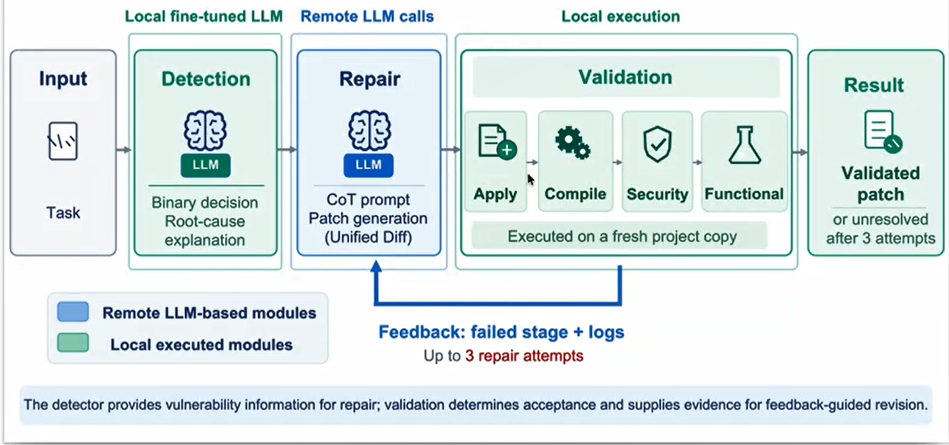
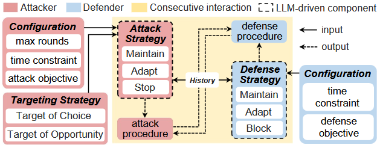
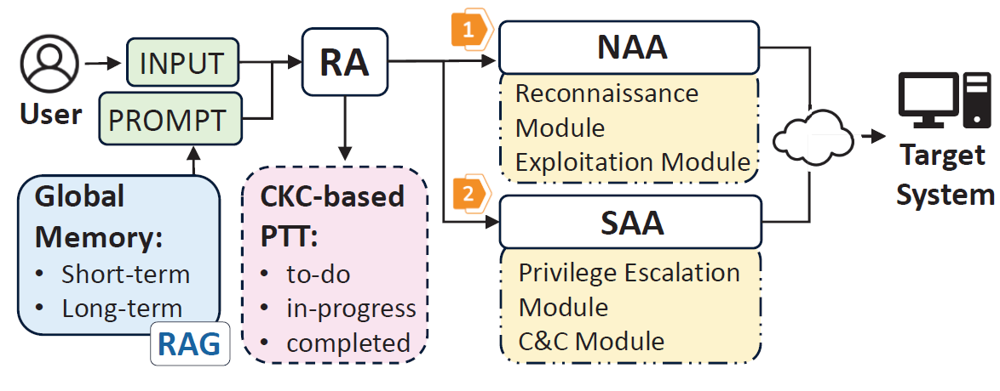
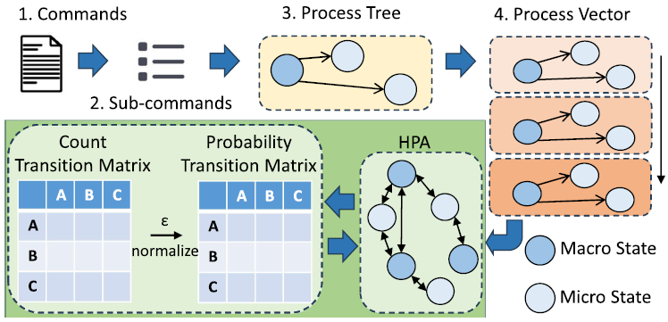
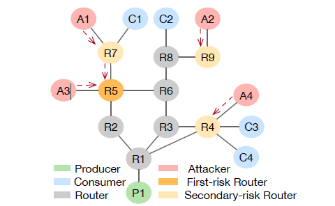
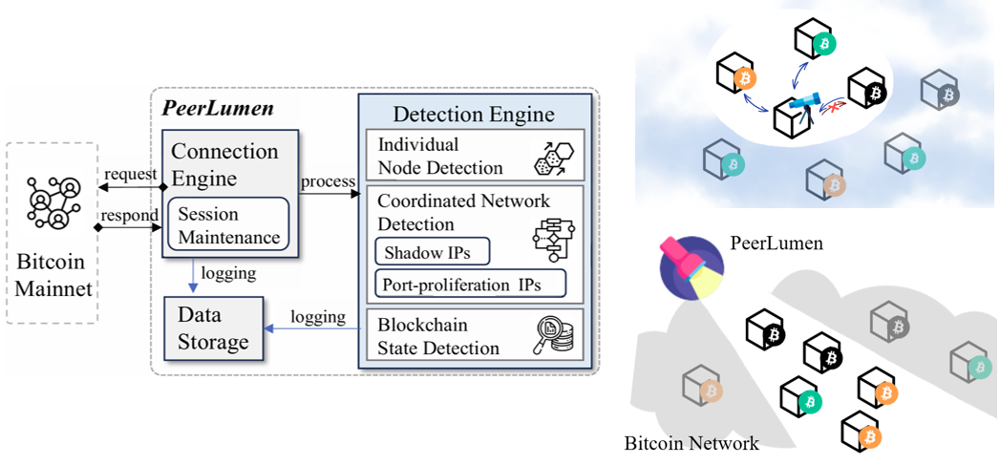

<!-- ============================================ -->
<!-- VulnLoop -->
<!-- ============================================ -->

### VulnLoop: AI Agent-Driven Vulnerability Discovery and Repair

  

    VulnLoop explores an AI agent-driven approach to automated software vulnerability discovery and repair. By leveraging intelligent agents and LLM-based reasoning, the framework aims to identify potential software vulnerabilities, analyze their root causes, and generate appropriate code-level fixes. Through an iterative discovery, analysis, repair, and validation process, this research investigates how autonomous AI agents can improve software security and facilitate continuous vulnerability remediation.
  

  <figure class="research-figure">
    
  </figure>

<!-- ============================================ -->
<!-- LLM-CW -->
<!-- ============================================ -->

### LLM-CW: LLM-Driven Cyber Wargaming for Evolving Attack-Defense Dynamics and Strategy Adaptation
  

  

    LLM-CW investigates the application of Large Language Models (LLMs) to cyber wargaming, focusing on evolving attack-defense interactions and adaptive strategy development. It explores how LLM-driven agents can simulate attacker and defender behaviors and adapt their strategies in response to evolving threats and defensive actions. By integrating intelligent decision-making into cyber wargaming, this work aims to advance autonomous adversarial simulation and strategic analysis for cybersecurity.
  

  <figure class="research-figure">
    
  </figure>

<!-- ============================================ -->
<!-- PentestLLM -->
<!-- ============================================ -->

### PentestLLM: LLM-Enabled Penetration Testing

  

    PentestLLM explores the application of Large Language Models (LLMs) to penetration testing, aiming to make security assessment more intelligent and automated. By leveraging LLM-based reasoning and tool integration, the framework investigates how AI can assist in understanding testing objectives, identifying potential attack paths, executing penetration-testing workflows, and interpreting security assessment results. This research aims to advance LLM-enabled penetration testing and reduce the complexity of security evaluation.

    

      <strong>Related publications:</strong>
       <a href="https://ieeexplore.ieee.org/abstract/document/11645571" target="_blank" rel="noopener">
         COMPSAC'26
       </a>
     

  

  <figure class="research-figure">
    
  </figure>

<!-- ============================================ -->
<!-- HoneyLLMd -->
<!-- ============================================ -->

### HoneyLLMd: A Large Language Model-Powered Adaptive Honeypot System

  

    Unlike traditional decoys, this work proposed an LLM powered honeypot system that generates authentic, shell-like responses without exposing a real operating system, facilitating convincing request–response interactions that capture valuable attacker behavioral data. To enhance defensive capabilities, we employ a Hierarchical Probabilistic Automaton (HPA) to model attack transitions and dynamically adapt honeypot strategies. Experimental results demonstrate that this approach achieves superior attacker engagement and data collection while maintaining significantly lower security risks.
   

      <strong>Related publications:</strong>
       <a href="https://link.springer.com/chapter/10.1007/978-981-97-8801-9_13" target="_blank" rel="noopener">
         ICICS'24 
       </a>,
       <a href="https://ieeexplore.ieee.org/abstract/document/11481625" target="_blank" rel="noopener">
         IEEE TNSE
       </a>
     

  

  
  <figure class="research-figure">
    
    <!--
    <figcaption>
      Overview of the LLM-powered adaptive honeypot system.
    </figcaption>
    -->
  </figure>

<!-- ============================================ -->
<!-- Link state for IFA -->
<!-- ============================================ -->

### Link State-enabled IFA Threat Detection and Tracing in Named Data Networking

  

This research investigates a cloud–edge cooperative defense system that leverages link state-based topology information to detect and trace IFA attacks in Named Data Networking (NDN). Routers in the edge layer share link-state data and traffic statistics with a detection engine in the cloud layer, enabling coordinated, topology-aware attack detection and traceback. Our experimental results demonstrate that the proposed method achieves over 99.9% detection accuracy and 80-95% mitigation efficiency under diverse network topologies.

    

      <strong>Related publications:</strong>
       <a href="https://ieeexplore.ieee.org/abstract/document/11587294" target="_blank" rel="noopener">
         ICC'26
       </a>,
       <a href="https://www.sciencedirect.com/science/article/abs/pii/S138912862600705X" target="_blank" rel="noopener">
         ComNet
       </a>
     

    
   

  <figure class="research-figure">
    
  </figure>

<!-- ============================================ -->
<!-- PeerLumen -->
<!-- ============================================ -->

### PeerLumen: Bitcoin P2P Network Telescope Honeypot

  

    PeerLumen investigates a honeypot telescope for monitoring and analyzing security threats in the Bitcoin P2P network. By observing network connections and peer behaviors, the system aims to collect valuable threat intelligence and characterize malicious activities within the Bitcoin ecosystem. The research explores network-level monitoring across IPv4, IPv6, and Tor onion services, providing insights into emerging threats, suspicious connection patterns, and the security dynamics of decentralized P2P networks.

    

      <strong>Related publications:</strong>
       <a href="https://ieeexplore.ieee.org/abstract/document/11664691" target="_blank" rel="noopener">
         DSN'26
       </a>
     

  

  <figure class="research-figure">
    
  </figure>

